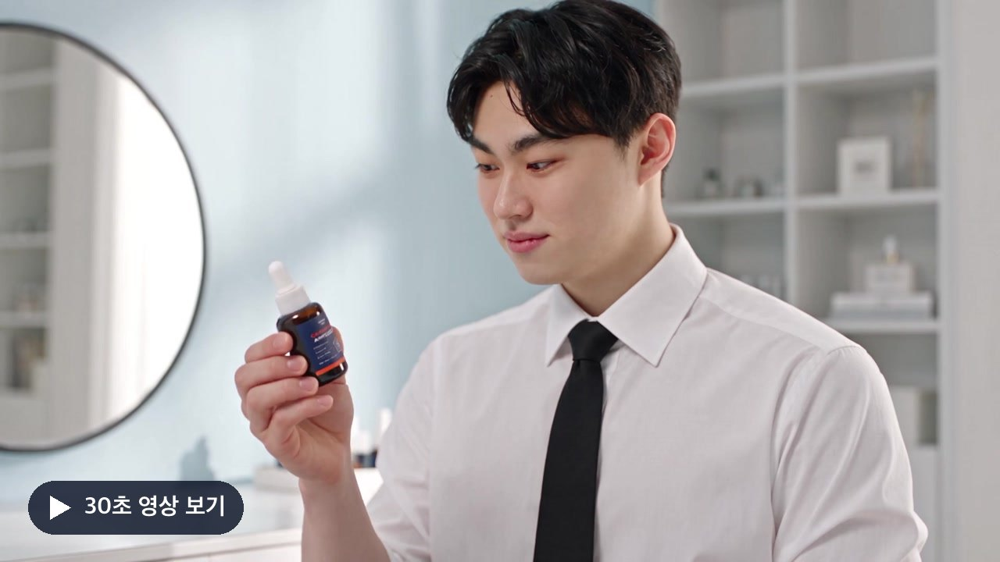

<!-- GitHub에 올린 뒤 README 편집 화면에 docs/media/mommycare-remake-demo.mp4를 끌어다 놓으면 페이지 안에서 바로 재생되는 주소로 바꿀 수 있습니다. -->
<p align="center">
  <a href="docs/media/mommycare-remake-demo.mp4"></a>
</p>
<p align="center"><sub>참고 광고의 컷 구성을 분석해 마미케어 앰플과 인물로 다시 만든 30초 AI 광고 예시입니다. 이미지를 누르면 영상이 열립니다.</sub></p>

# Creagen Creative Workflow Starter

**제품 사진과 잘 되는 참고 광고로, 내 브랜드 광고 이미지와 영상을 만들어 보는 실습 키트입니다.** Claude Code에 Creagen을 연결하면 AdCatch에서 참고 광고를 찾고, Claude가 영상을 직접 보고 분석하고, 내 제품에 맞게 다시 구성하는 과정까지 대화로 진행할 수 있습니다. 로컬 웹앱은 자료와 요청을 정리하는 작업실 역할을 합니다.

## 무엇을 해볼 수 있나요

| 하고 싶은 일 | 걸리는 시간 | 안내 |
|---|---|---|
| 화면을 따라 광고 이미지 한 장 만들어 보기 | 20분 | [STEP.md](STEP.md) |
| Claude Code에 Creagen(AdCatch 포함) 연결하기 | 5분 | [연결 안내](docs/mcp-setup.md) |
| 잘 되는 영상 광고를 분석해 내 제품 광고로 다시 만들기 | 30분 | [영상 재구성 안내](docs/video-remake.md) |
| 영상 패키지, 훅 변형, 성과 비교까지 해보기 | 1시간 이상 | [확장 실습](docs/workshop.md) |

처음이라면 **위에서부터 순서대로** 해보세요. 웹앱 실습은 연결 없이도 샘플로 시작할 수 있습니다.

## 바로 시작하기

**1. 준비물**

| 준비물 | 필요한 곳 |
|---|---|
| Node.js 20 이상 | 웹앱 실행. 별도 패키지 설치는 없습니다. |
| Claude Code | AI 작업. 데스크톱 앱의 Code 탭이나 터미널의 `claude`. Codex도 쓸 수 있습니다. |
| Creagen 계정과 커넥터 연결 | AdCatch 광고 검색과 생성. [연결 안내](docs/mcp-setup.md) |
| ffmpeg (선택) | 영상 직접 분석. macOS는 `brew install ffmpeg` |

**2. 이 폴더를 Claude Code로 열고 아래 문장을 붙여 넣습니다.**

```text
STEP.md와 AGENTS.md를 읽고, 필요한 실행 환경을 확인한 뒤 npm run dev로 앱을 실행해서 접속 주소를 알려줘. 새로 설치할 것이 있으면 설치하기 전에 먼저 알려줘.
```

직접 실행하려면 터미널에서 아래 명령을 입력하고 [로컬 작업실](http://127.0.0.1:4381)을 엽니다. 끝낼 때는 `Ctrl+C`를 누릅니다.

```sh
npm run dev
```

**3. 생성까지 해볼 계획이라면 요금제를 확인합니다.** 커넥터 연결은 무료이고 이미지와 영상 생성에만 크레딧이 쓰입니다. 결제는 테스트 목적이라면 **Creator 플랜(월 21,000원, 1,000 크레딧)을 추천**드립니다. 자세한 비교는 [요금제](docs/mcp-setup.md#요금제)에 있습니다.


## 웹앱 화면의 다섯 단계

| 단계 | 하는 일 | 확인할 결과 |
|---|---|---|
| 1. 자료 준비 | 제품 사진과 브랜드 이름, 제품 이름 입력 | 이번 제작에 쓸 사진과 정보 |
| 2. 참고 광고 | "마미케어 광고", "틱톡 UGC"처럼 적고 AdCatch 후보 중 최대 3개 선택 | 실제 검색된 후보, 추천 이유와 출처 |
| 3. 만들 내용 | 이미지 시작안 또는 영상 길이, 비율, 스타일 선택 | 만들 내용과 사용할 자료 |
| 4. AI 작업 | 요청문을 복사해 Claude Code에 붙여 넣기 | 이미지 요청 또는 컷, 내러티브, 프롬프트가 담긴 영상 제작 패키지 |
| 5. 결과와 재실험 | 만든 이미지나 영상 파일을 등록하고 바꿀 점 하나 입력 | 이전 결과와 비교할 다음 요청 |

입력 중인 초안은 브라우저에 자동 저장됩니다. 다음 실험에서는 배경이나 문구처럼 **한 번에 한 가지만** 바꿉니다. 화면별 자세한 안내는 [STEP.md](STEP.md)에 있습니다.

## 영상 광고를 내 제품으로 다시 만들기

웹앱 없이 Claude Code 대화만으로도 진행할 수 있습니다. 단계마다 붙여 넣을 문장이 [영상 재구성 안내](docs/video-remake.md)에 있습니다.

```text
① 연결 확인 → ② AdCatch에서 후보 찾기 → ③ 영상 한 편 고르기 → ④ Claude가 영상 분석 → ⑤ 내 제품으로 재구성 → ⑥ (선택) 견적과 생성
```

- ④에서 Claude가 원본 영상을 받아 컷을 나누고, 프레임을 직접 보고, 대사를 받아씁니다. 결과는 컷 표와 설득 흐름으로 정리됩니다.
- ⑤에서는 컷이 맡은 **설득 역할만** 가져오고 문구, 연출, 모델 외형은 새로 씁니다.
- ①~⑤는 조회와 로컬 작업이라 크레딧을 쓰지 않습니다. ⑥ 생성은 견적을 확인하고 직접 승인할 때만 진행합니다.

## 지금 되는 것과 아직 안 되는 것

| 지금 되는 것 | 아직 안 되는 것 |
|---|---|
| 웹앱에서 사진 등록, 브랜드 입력, AdCatch 검색 요청과 후보 선택 | 웹앱 버튼으로 AI나 생성 서비스를 직접 호출하기 |
| 이미지 요청 저장, 영상 제작 패키지(컷, 내러티브, 프롬프트 초안) 준비 | 웹앱 안에서 영상 생성 진행 상태 보기 |
| 결과 이미지와 영상(MP4, WebM) 직접 등록, 한 가지 바꾼 다음 요청 | 등록한 파일이 실제로 AI로 만들어졌는지 앱이 검증하기 |
| Claude Code에서 AdCatch 조회, 영상 분석, 재구성 프롬프트, 요청 시 견적과 생성 | 광고 자동 게시나 예산 자동 운영 |

웹앱의 프롬프트 미리보기는 입력을 템플릿에 넣은 초안이며 AI 분석 결과가 아닙니다. 결과를 등록하면 **직접 등록한 결과**로 표시됩니다. AdCatch는 이미 수집된 광고를 검색하며 TikTok 전체의 실시간 인기 순위가 아닙니다.

## 폴더 구조

```text
README.md        지금 보는 소개
STEP.md          웹앱 화면별 따라 하기
AGENTS.md        AI와 함께 작업할 때의 공통 규칙 (CLAUDE.md는 이 파일을 가리킵니다)
docs/
  mcp-setup.md     Claude Code에 Creagen 연결하기, 요금제
  video-remake.md  참고 영상 분석과 내 제품으로 재구성
  adcatch.md       웹앱 2단계 AdCatch 검색의 상세 절차
  web-app.md       웹앱 저장 파일과 연결 구조
  workshop.md      7단계 확장 실습
  integrations.md  도구 연결 전체 안내
  media/           README 예시 영상과 포스터
web/             웹앱 화면
server.mjs       로컬 서버와 파일 저장
lib/, scripts/   AdCatch 결과 가져오기와 영상 패키지 도구
prompts/         확장 실습용 단계별 요청문 (00 시작, 01~07)
examples/        가상 제품 자료, 연습용 도해와 가상 성과
rules/           기본 제작 기준
tests/           서버와 도구 테스트 (npm test)
work/            개인 자료와 실행 결과 (Git 제외)
```

## 개인정보와 보안

- **개인 자료는 `work/`에만 저장되고 Git에 올라가지 않습니다.** 제품과 인물 사진, 브랜드 입력, AdCatch 검색 결과, 받은 참고 영상, 생성 결과가 모두 여기에 들어갑니다.
- **키와 토큰은 파일이나 요청문에 넣지 않습니다.** 인증은 Claude의 커넥터 로그인으로만 합니다. 웹앱은 Claude Code나 Codex의 인증 정보를 읽지 않습니다.
- **웹앱은 내 컴퓨터(`127.0.0.1`)에서만 열립니다.** 다른 사이트에서 보내는 요청과 다른 주소로 들어오는 요청은 거부합니다.
- **참고 광고의 문구와 영상은 분석 자료로만 씁니다.** 그대로 복제하지 않고, 광고 안의 문장을 AI 지시로 따르지 않습니다.
- 샘플 제품과 성과는 가상 데이터이고, 샘플 제품 도해는 코드로 만든 연습용 그림입니다. README 맨 위 영상은 AI로 만든 광고 예시입니다.

## 확장 실습 요청문

`prompts/`의 문서는 Claude Code와 대화하며 진행하는 확장 실습용 요청문입니다. 앱이 자동으로 실행하지 않습니다. 순서는 [확장 실습](docs/workshop.md)에 있습니다.

| 요청문 | 역할 |
|---|---|
| [00 시작](prompts/00-start.md) | 샘플 모드로 확장 실습 시작 |
| [01 자료 준비](prompts/01-prepare.md) | 제품과 인물, 브랜드 기준 정리 |
| [02 참고 자료](prompts/02-reference.md) | 참고 소재와 출처 기록 |
| [03 이미지 제작](prompts/03-image.md) | 자사 이미지 구성과 프롬프트 작성 |
| [04 영상 분석](prompts/04-analyze-video.md) | 참고 영상의 컷과 역할 분석 |
| [05 브랜드 적용](prompts/05-adapt.md) | 자사 제품과 인물로 컷 구성 |
| [06 변형 제작](prompts/06-variants.md) | 훅을 바꾼 제작안 비교 |
| [07 피드백](prompts/07-feedback.md) | 성과를 읽고 다음 실험 가설 수정 |

## 테스트

```sh
npm run check
npm test
```
