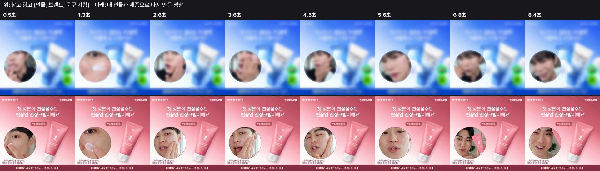
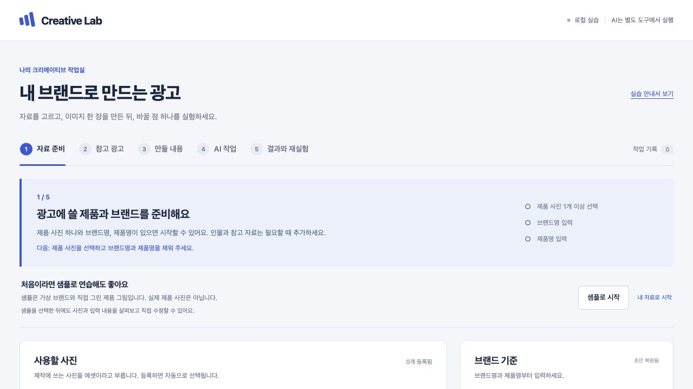

# 크리젠(Creagen) Seedance 2.5 기반 광고 소재 재생성 핸즈온

<p align="center">
  <a href="docs/media/mommycare-cream-remake.mp4"></a>
</p>
<p align="center"><sub>위는 AdCatch에서 찾은 참고 광고(인물, 브랜드, 문구는 가림), 아래는 그 광고의 화면 구성, 카메라, 동작, 컷 타이밍을 그대로 따라 내 인물과 제품으로 Seedance 2.5에서 다시 만든 영상입니다. 같은 시간의 장면을 나란히 놓았습니다. 이미지를 누르면 다시 만든 영상(mp4)을 볼 수 있습니다.</sub></p>

<p align="center">
  <a href="docs/media/mommycare-remake-demo.mp4"></a>
</p>
<p align="center"><sub>참고 광고의 컷 구성을 분석해 마미케어 앰플과 인물로 다시 만든 30초 AI 광고 예시입니다. 이미지를 누르면 영상 파일(mp4)이 열리거나 내려받아지고, 그 파일로 소리와 함께 볼 수 있습니다.</sub></p>

**잘 되는 광고를 참고해서 내 제품 광고 이미지와 영상을 만들어 보는 실습입니다.** 처음 한 번 설정을 마치면, 그다음은 아래 문장을 Claude에 **복사해서 붙여 넣기만** 하면 Claude가 참고 광고를 찾고, 영상을 직접 보고 분석하고, 내 제품에 맞게 다시 구성해 줍니다.

## 준비물

| 준비물 | 설명 |
|---|---|
| Claude 유료 구독 | Pro, Max, Team, Enterprise 중 하나. 무료 플랜은 Code 탭을 쓸 수 없습니다. 회사에서 받은 Team이나 Enterprise 계정이면 Creagen 연결을 조직의 Owner나 Primary Owner가 먼저 추가해야 할 수 있으니 실습 전에 부탁해 둡니다. |
| Claude 데스크톱 앱 | [여기서 내려받습니다](https://claude.ai/download). 앱 안의 **Code** 탭을 씁니다. 설치부터 설정까지는 아래 [시작 전 설정](#시작-전-설정-처음-한-번만)에 있습니다. |
| Creagen 계정 | 실습 전에 [Creagen 가입 페이지](https://creagen.vcat.ai/sign-up)에서 가입해 둡니다. **Google로 시작**처럼 쓰던 계정으로 가입하면 가장 빠릅니다. 이메일로 가입하면 24시간 안에 메일 인증을 마쳐야 합니다. 어떤 방법으로 가입했는지 기억해 둡니다. 광고 찾기와 영상 만들기에 씁니다. |
| 실습 폴더 | 이 저장소에 초대받은 GitHub 계정, 또는 진행자에게 받은 ZIP 파일 |
| 내 브랜드 홈페이지 주소 | AdCatch에 내 브랜드를 등록할 때 씁니다. 경쟁사 이름도 알면 적어 둡니다. |
| 내 제품 사진 1장 | 제품 모양과 이름이 잘 보이는 사진. 1단계에서 압축을 푼 실습 폴더 안에 넣어 둡니다. 없으면 샘플로 연습합니다. |

영상을 실제로 만들어 보려면 Creagen 유료 플랜이 필요합니다. 처음 테스트라면 **Creator 플랜(월 21,000원, 1,000 크레딧)을 추천**합니다. 이 실습의 10초 영상은 한 편에 약 585 크레딧이라, Creator로 한 달에 한 편 정도 만들어 볼 수 있습니다. 맨 위 예시 같은 30초 영상은 Creator 한 달 크레딧보다 많이 듭니다. Creagen 연결은 무료이고, 크레딧은 이미지와 영상을 만들 때만 쓰입니다. 결제할 때는 요금제 페이지에서 **매월**을 누른 뒤 Creator의 **월간 구독**을 누릅니다. 처음에는 연간 가격이 보이니 주의합니다. [요금제 자세히 보기](docs/mcp-setup.md#요금제)

필요한 프로그램은 3단계에서 할 일을 고른 뒤 Claude가 확인하고, 설치하기 전에 먼저 물어봅니다. 예를 들어 B는 실습 앱을 켜는 프로그램(Node.js), A는 영상을 장면별로 나누는 프로그램(ffmpeg)이 필요할 수 있습니다.

### Claude가 물어볼 때는 이렇게 답합니다

| Claude가 묻는 것 | 이렇게 답하기 |
|---|---|
| 프로그램을 설치해도 되는지 | `응, 설치해줘` |
| 명령 실행을 허용할지 묻는 창 | 내용이 실습 폴더 안의 작업이면 **허용** |
| Mac 비밀번호나 터미널 입력이 필요하다고 할 때 | `비밀번호 없이 할 수 있는 방법으로 해줘. 없으면 그 단계는 건너뛰자` |
| 제품 사진이 어디 있는지 | 실습 폴더에 넣은 사진의 파일 이름. 예: `앰플정면.jpg` |
| 사진이 없을 때 | `샘플 제품으로 해줘` |
| 크레딧이 드는 생성을 해도 되는지 | 견적을 확인하고 원할 때만 `승인, 진행해줘` |
| Creagen 도구를 써도 되는지 묻는 창 | 목록 보기, 광고 찾기 같은 조회면 허용합니다. 그 밖에는 바로 전에 내가 대화창에서 `승인, 진행해줘`라고 쓰거나 등록해 달라고 한 일일 때만 허용합니다 |
| 일을 여러 AI에게 나눠 맡길지 묻는 카드 (**Once**, **Always**, **Deny**) | **Once**. 같은 카드가 계속 뜨면 **Always** |
| 어떤 작업이 막혔다고 할 때 | `막힌 작업이 무엇인지 쉽게 설명하고 다른 방법이 있으면 알려줘` |

권한 모드를 **Auto**(자동)로 두면 이런 창이 훨씬 덜 뜹니다. 아래 시작 전 설정 5번을 봅니다.

## 따라 하기

### 시작 전 설정 (처음 한 번만)

순서는 Claude 앱과 Code 탭, 모델 Opus 5.5, Ultracode, 권한 모드 Auto, Creagen 연결입니다. 앱 설치와 모델은 처음 한 번만 하고, 권한 모드는 실습 폴더를 고른 뒤 새 세션(새 대화)마다 확인합니다.

1. **Claude 앱 설치하고 로그인하기.** [claude.ai/download](https://claude.ai/download)에서 내 컴퓨터(Mac 또는 Windows)에 맞는 파일을 내려받아 설치합니다. 앱을 열고(Mac은 응용 프로그램 폴더의 Claude) 유료 구독 중인 Claude 계정으로 로그인합니다. 이 이메일은 아래 2단계(Creagen 연결)에서도 씁니다.
2. **Code 탭 열기.** 앱 사이드바 맨 위의 **Code**를 누릅니다. 아이콘만 보이면 마우스를 올려 이름을 확인합니다.
   - 성공: 글을 쓰는 입력창이 보이고, 그 아래 줄에 실행 위치, 폴더, 모드, 모델을 고르는 버튼이 있습니다.
   - 업그레이드 안내가 뜨면 무료 계정입니다. [claude.ai/upgrade](https://claude.ai/upgrade)에서 Pro 이상으로 구독한 뒤 다시 엽니다.
   - 로그인 안내나 403 오류가 뜨면 앱 메뉴에서 로그아웃했다가 다시 로그인합니다. 그래도 안 되면 앱을 완전히 종료했다가(Mac은 `Cmd+Q`) 다시 엽니다. 창만 닫으면 안 됩니다.
3. **모델을 Opus 5.5로 고르기.** 입력창 아래 줄 오른쪽의 모델 이름을 눌러 **Opus 5.5**를 고릅니다. 찾기 어려우면 Mac은 `Cmd+Shift+I`로 모델 목록을 엽니다.
   - 성공: 모델 이름이 Opus 5.5로 바뀝니다.
   - 목록에 없으면 앱이 예전 버전일 수 있습니다. Mac은 화면 맨 위 메뉴의 **Claude > Check for Updates…**, Windows는 **Help > Check for Updates…**로 업데이트하고 새 세션을 엽니다. 그래도 없으면 진행자에게 알립니다.
4. **Ultracode 켜기.** 이 실습에서는 문장 맨 앞에 `ultracode`를 써서 켭니다. 그 문장의 일에만 켜지고, 1단계와 3단계 문장에는 이미 들어 있습니다. Claude가 여러 AI에게 일을 나눠 맡기고 서로 검증해 결과가 꼼꼼한 대신, 시간이 더 걸리고 사용량이 많이 듭니다.
   - Pro 플랜이면 먼저 확인합니다. 입력창에 `/config`를 붙여 넣고 Enter를 누른 뒤, 열린 설정에 **Dynamic workflows** 항목이 꺼져 있으면 켭니다. 항목이 보이지 않으면 진행자에게 알립니다. 그대로 진행해도 실습은 되지만 Ultracode 없이 진행될 수 있습니다.
   - 일을 나눠 맡기면 창 맨 위 제목 줄의 **⋮** 메뉴에서 **Background tasks**를 열어 진행 상황을 볼 수 있습니다. 가벼운 일은 나누지 않을 수 있으니 보이지 않아도 정상입니다.
   - 사용 한도에 닿았다는 안내가 뜨면 안내된 시간까지 기다립니다. 한도에 가까워졌다는 안내라면 ④ 정밀 분석이 아닌 단계는 맨 앞의 `ultracode`를 빼고 보내도 됩니다.
5. **권한 모드를 Auto(자동)로 고르기.** 입력창 아래 줄의 모드 버튼을 눌러 **Auto**를 고릅니다. 찾기 어려우면 Mac은 `Cmd+Shift+M`으로 모드 목록을 엽니다. 모드는 폴더마다 따로 기억되므로 1단계에서 실습 폴더를 고른 뒤에 고릅니다.
   - 성공: 모드 버튼에 Auto가 보입니다. 실습 폴더 안의 파일을 읽고 고치는 일은 하나하나 묻지 않습니다.
   - 목록에 Auto가 없으면 회사 정책으로 막혔거나, 모델이 맞지 않거나, 잠시 꺼진 경우입니다. 모델이 Opus 5.5인지 보고, 그래도 없으면 **Accept edits**를 고르고 나중에 새 세션에서 다시 확인합니다. Accept edits에서는 명령을 실행할 때마다 허용 창이 뜨니 위 표대로 답합니다.
   - 목록에 **Bypass permissions**가 보여도 고르지 않습니다. 모든 확인을 끄는 모드입니다.
   - Auto여도 크레딧이 드는 생성은 Claude가 견적을 먼저 보여주고 내가 `승인, 진행해줘`라고 쓸 때만 진행합니다. 브랜드 등록은 바뀌는 내용을 먼저 보여주고 내 확인을 받습니다.
6. **Creagen 연결하기.** 실습 폴더를 연 뒤 아래 [2단계](#2단계-creagen-연결하기-처음-한-번만)에서 합니다.

### 1단계. 실습 폴더 열기

1. 이 GitHub 페이지 위쪽의 초록색 **Code** 버튼 → **Download ZIP**을 누릅니다. (Claude 앱의 Code 탭과는 다른 버튼입니다.) 이 저장소는 비공개라, 저장소에 초대받은 GitHub 계정으로 로그인해야 보입니다. 진행자에게 ZIP 파일을 받아도 됩니다.
2. 내려받은 파일의 압축을 풉니다. Mac은 더블클릭, Windows는 마우스 오른쪽 버튼 → **모두 압축 풀기**. 이미 폴더로 풀려 있으면 그대로 씁니다. `creagen-creative-workflow-starter-main` 같은 이름의 폴더가 생깁니다. 바탕화면처럼 찾기 쉬운 곳으로 옮겨 둡니다.
3. 제품 사진이 있으면 이 폴더 안에 넣어 둡니다.
4. Claude 앱의 **Code** 탭에서 새 세션(새 대화)을 엽니다. 이미 대화 중이면 사이드바의 **+ New**를 누릅니다(Mac은 `Cmd+N`).
5. 입력창 아래 줄의 맨 앞 버튼이 **Local**(내 컴퓨터)로 되어 있는지 봅니다. 아니면 눌러서 Local 아래 첫 항목을 고릅니다. 그 옆 폴더 버튼에서 **Open folder…**를 눌러 압축을 푼 폴더를 고릅니다.
   - 열었을 때 README.md가 바로 보이는 폴더를 고릅니다. 안에 같은 이름의 폴더가 한 번 더 있으면 그 안쪽 폴더입니다.
   - 입력창 아래에 이런 버튼이 없으면 앱이 예전 버전입니다. [시작 전 설정](#시작-전-설정-처음-한-번만) 3번처럼 업데이트합니다.
6. 같은 줄에서 모델이 **Opus 5.5**인지 보고, 모드 버튼에서 **Auto**를 고릅니다([시작 전 설정](#시작-전-설정-처음-한-번만) 5번).
7. 아래 문장을 붙여 넣고 Enter를 누릅니다.

```text
ultracode 이 폴더의 README.md, STEP.md, AGENTS.md를 읽고 실습할 준비가 됐는지 확인해줘. 필요한 프로그램이 없으면 설치하기 전에 나에게 먼저 물어봐. 아직 A, B, C 중에 고르지 않았으니 공통 준비만 확인하고, 경로별 프로그램은 3단계에서 고른 뒤에 확인해줘. 지금 이 대화의 모델 이름도 알려줘.
```

**이렇게 되면 성공:** Claude가 모델 이름(Opus 5.5)과 함께 준비가 됐다고 하거나, 무엇이 더 필요한지 알려줍니다. 몇 분 걸릴 수 있습니다. 그동안 다른 창을 봤다면 Claude 앱으로 돌아와 허용 창이나 질문이 떠 있는지 확인합니다. 다른 모델 이름이 나오면 시작 전 설정 3번대로 Opus 5.5로 바꾸고 같은 문장을 다시 보냅니다.

### 2단계. Creagen 연결하기 (처음 한 번만)

Creagen 하나만 연결하면 AdCatch도 함께 쓸 수 있습니다.

1. [Creagen 연결 페이지](https://creagen.vcat.ai/mcp)에서 **Claude에 추가**를 누릅니다. 인터넷 창(브라우저)에 Claude 화면이 열립니다.
2. Claude 로그인 화면이 나오면 Claude 앱과 같은 이메일로 로그인합니다. 다른 계정으로 로그인되어 있으면 로그아웃하고 같은 계정으로 다시 로그인합니다.
   - 로그인한 뒤 커넥터 추가 화면이 아니라 Claude 첫 화면이 나오면, Creagen 연결 페이지로 돌아가 **Claude에 추가**를 한 번 더 누릅니다.
3. 이름(Creagen)과 주소가 채워져 있는지 봅니다. **계속**이 나오면 누르고, 마지막에 **추가**를 누릅니다. 다른 칸은 바꾸지 않습니다.
   - 이름과 주소가 비어 있으면 Creagen 연결 페이지에서 **커넥터 URL 복사**를 누르고, **수동으로 추가하기**를 펼쳐 **Claude 커넥터 설정 열기**를 누릅니다. 이름에 `Creagen`을 적고 주소 칸에 붙여 넣습니다.
   - 회사 Team이나 Enterprise 계정이라 추가가 안 되면 [연결 안내 방법 1](docs/mcp-setup.md#방법-1-버튼으로-추가-추천)의 회사 플랜 안내를 봅니다.
4. Creagen 로그인 화면이 뜨면 Creagen에 가입할 때 쓴 방법 그대로 로그인하고 연결을 승인합니다. 다른 방법으로 로그인하면 다른 계정으로 잡힐 수 있습니다. 로그인 화면이 뜨지 않으면 커넥터 목록에서 Creagen 옆의 **연결**을 누릅니다.
5. Claude 앱으로 돌아와 **+ New**(Mac은 `Cmd+N`)로 새 세션(새 대화)을 엽니다. 1단계 5번처럼 같은 실습 폴더를 고르고, 모델 **Opus 5.5**와 모드 **Auto**를 확인합니다. 연결 전에 열어 둔 세션에서는 Creagen이 보이지 않을 수 있습니다. 3단계도 이 새 세션에서 이어 갑니다.
6. 아래 문장을 붙여 넣습니다.

```text
Creagen 연결을 확인해줘. 조회만 하고 등록, 생성, 변경은 하지 마. 내 계정과 AdCatch에 등록된 브랜드, 경쟁사 목록을 보여줘.
```

**이렇게 되면 성공:** 내 Creagen 이메일이 나오면 연결은 성공입니다. 브랜드나 경쟁사가 0개인 것은 정상입니다.

**연결이 안 된 것:** Claude가 Creagen 도구가 없다고 하면 [자주 막히는 곳](docs/mcp-setup.md#자주-막히는-곳), 로그인이 필요하다고 하면 [연결 확인](docs/mcp-setup.md#연결-확인)을 봅니다.

**브랜드가 0개면 광고를 찾기 전에 꼭 등록합니다.** AdCatch 광고 찾기는 등록한 브랜드가 있어야 됩니다. 처음 가입한 계정은 대부분 여기서 시작합니다. `[대괄호]` 부분만 내 값으로 바꿉니다. 경쟁사를 아직 모르면 `경쟁사는 [경쟁사 이름].` 부분을 지우고 붙여 넣습니다.

```text
AdCatch에 내 브랜드와 경쟁사를 등록하고 싶어. 내 브랜드는 [브랜드 이름], 홈페이지는 [내 브랜드 홈페이지 주소]. 경쟁사는 [경쟁사 이름]. 필요한 정보가 있으면 물어보고, 무엇이 바뀌는지와 비용이 드는지 먼저 보여준 뒤 내가 확인하면 등록해줘.
```

새로 등록한 경쟁사의 광고는 모이는 데 시간이 걸릴 수 있습니다. 단어로 찾기는 등록 직후에도 해 볼 수 있습니다.

### 3단계. 해보고 싶은 것 고르기

**A. 잘 되는 영상 광고를 내 제품 광고로 다시 만들기 (1시간 안팎)**

```text
ultracode docs/video-remake.md를 읽고 첫 단계부터 같이 진행해줘. 단계마다 무엇을 하는지 짧게 설명하고, 내가 확인하면 다음 단계로 넘어가줘. 크레딧이 드는 일은 견적을 먼저 보여주고 내 승인을 기다려줘.
```

Claude가 AdCatch에서 후보를 찾고, 고른 영상을 장면, 카메라, 화면 배치, 대사까지 정밀하게 분석합니다. 그다음 같은 구성을 내 인물과 제품으로 다시 만드는 생성 문장과 편집 사양을 만들어 줍니다. 영상까지 만들고 싶으면 마지막에 견적을 보고 승인하면 됩니다. 자세한 단계와 단계별 질문은 [영상 다시 만들기 안내](docs/video-remake.md)에 있습니다.

**B. 화면을 보며 광고 이미지 한 장 만들기 (20분)**

```text
ultracode 실습 앱을 켜고 브라우저로 열 주소를 알려줘. 그다음 STEP.md 순서대로 내가 화면에서 할 일을 한 단계씩 안내해줘.
```

**C. 영상 기획, 첫 장면(훅) 바꾸기, 성과 비교까지 해보기 (1시간 이상)**

```text
ultracode docs/workshop.md를 읽고 확장 실습을 샘플 자료로 시작해줘. 단계마다 만든 파일과 다음 할 일을 짧게 알려주고, 내가 확인하면 다음 단계로 넘어가줘.
```

A와 C는 Claude가 다음 단계로 갈지 물으면 `ultracode 응, 다음 단계로 가줘`라고 답합니다. 맨 앞의 `ultracode`를 빼면 그 단계는 Ultracode 없이 진행됩니다. 단계마다 사용량이 늘어 Pro는 한도에 빨리 닿을 수 있습니다. 단계별 문장은 Claude가 알아서 읽습니다.

## 실습 앱 화면 (B를 고른 경우)



| 단계 | 하는 일 | 확인할 결과 |
|---|---|---|
| 1. 자료 준비 | 제품 사진과 브랜드 이름, 제품 이름 입력 | 이번에 쓸 사진과 정보 |
| 2. 참고 광고 | "마미케어 광고", "틱톡 UGC"(사용 후기형 영상)처럼 적고 후보 중 최대 3개 선택 | 실제로 찾은 광고, 추천 이유와 출처 |
| 3. 만들 내용 | 이미지 시작 방향 또는 영상 길이, 비율, 스타일 선택 | 만들 내용과 쓸 자료 |
| 4. AI 작업 | 요청문을 복사해 Claude에 붙여 넣기 | 이미지 요청 또는 장면별 영상 제작 계획 |
| 5. 결과와 재실험 | 만든 이미지나 영상을 올리고 바꿀 점 하나 적기 | 이전 결과와 비교할 다음 요청 |

화면별 자세한 안내는 [STEP.md](STEP.md)에 있습니다. 다음 실험에서는 배경이나 문구처럼 **한 번에 한 가지만** 바꿉니다.

실습 앱의 영상 요청은 제작 계획까지만 만들고 크레딧을 쓰지 않습니다. 그 계획으로 영상을 만들고 싶으면 [영상 다시 만들기 안내](docs/video-remake.md)의 ⑥처럼 대화창에서 직접 요청하고, 견적을 확인한 뒤 승인합니다.

## 영상 다시 만들기는 이렇게 진행됩니다

**① 연결 확인 → ② 참고 광고 찾기 → ③ 영상 한 편 고르기 → ④ Claude가 영상 정밀 분석 → ⑤ 내 인물과 제품으로 다시 구성 → ⑥ (원할 때만) 견적 보고 만들기 → ⑦ 편집하고 디자인 판 합성**

- ④에서 Claude가 Opus 5.5와 Ultracode로 영상을 직접 보고, 장면마다 카메라 거리와 움직임, 손동작, 표정, 화면 배치와 색, 대사 속도와 타이밍을 숫자로 기록합니다. 컷 시간은 0.001초까지 적습니다.
- ⑤에서는 원본의 화면 구성, 카메라, 동작, 장면 길이를 **그대로 따르고**, 인물, 제품, 문구, 로고는 내 것으로 바꿉니다. 다른 브랜드의 문구, 로고, 상표, 제품, 인물 얼굴은 쓰지 않습니다.
- ①~⑤와 ⑦은 크레딧을 쓰지 않습니다. ⑥은 대화창에서 내가 직접 만들어 달라고 요청하고, 견적과 남은 크레딧을 확인한 뒤 승인할 때만 만듭니다. 참고로 10초 영상 한 편은 약 585 크레딧이었습니다.

## 지금 되는 것과 아직 안 되는 것

| 지금 되는 것 | 아직 안 되는 것 |
|---|---|
| A. Claude 대화로 광고 찾기, 영상 정밀 분석, 내 제품으로 다시 구성, 견적 확인 후 승인하면 영상 만들기 | 실습 앱에서 바로 영상 만들기 (영상은 대화창에서 승인 후 만듭니다) |
| B. 실습 앱에서 사진 등록, 참고 광고 고르기, 이미지 요청과 영상 제작 계획 저장, 결과 올리기 | 올린 파일이 정말 AI로 만들어졌는지 앱이 확인하기 |
| 만든 결과를 보고 한 가지 바꿔 다시 요청하기 | 광고 자동 게시나 예산 자동 운영 |

AdCatch는 이미 모아 둔 광고를 찾아 줍니다. 틱톡 전체의 실시간 인기 순위는 아닙니다. 성과 표시도 관찰 신호이며 실제 매출이 아닙니다.

## 개인정보와 보안

- **내 사진, 브랜드 정보, 찾은 광고, 만든 결과는 내 컴퓨터의 `work/` 폴더에만 저장됩니다.** GitHub에 올라가지 않습니다.
- **비밀번호나 키를 Claude에 붙여 넣지 않습니다.** 연결은 위의 로그인 절차로만 합니다.
- **실습 앱은 내 컴퓨터 안에서만 열립니다.** 다른 사이트에서 오는 요청은 막습니다.
- **참고 광고는 분석 자료로만 씁니다.** 그대로 베끼지 않고, 광고 안의 문장을 Claude가 지시로 따르지 않습니다.
- 샘플 제품과 성과는 가상 자료입니다. 맨 위 영상은 AI로 만든 광고 예시입니다.

## 더 알아보기

| 문서 | 내용 |
|---|---|
| [STEP.md](STEP.md) | 실습 앱 화면별 따라 하기 |
| [Claude 앱에 Creagen 연결하기](docs/mcp-setup.md) | Creagen 연결 방법, 요금제, 막힐 때 |
| [영상 다시 만들기 안내](docs/video-remake.md) | 단계별 붙여 넣을 문장과 결과 예시 |
| [확장 실습](docs/workshop.md) | 영상 기획, 첫 장면(훅) 바꾸기, 성과 비교 |

<details>
<summary>개발자용 정보 (직접 실행, 폴더 구조, 테스트)</summary>

### 직접 실행

Node.js 20 이상에서 별도 패키지 설치 없이 실행합니다. 끝낼 때는 `Ctrl+C`를 누릅니다.

```sh
npm run dev
```

실행하면 실습 앱 주소가 출력됩니다(보통 http://127.0.0.1:4381). 4381 포트를 다른 프로그램이 쓰고 있으면 4382처럼 다음 번호로 열리니, 출력된 주소를 엽니다. 포트를 고정하려면 `CREATIVE_LAB_PORT`, 저장 폴더를 바꾸려면 `CREATIVE_LAB_DATA_DIR`를 씁니다. 예: `CREATIVE_LAB_PORT=5301 npm run dev`. 포트를 고정하면 그 포트가 사용 중일 때 다음 번호로 넘어가지 않습니다.

영상 분석에는 `ffmpeg`가 필요하고, 대사 받아쓰기에는 `whisper`를 선택해서 씁니다.

### 폴더 구조

```text
README.md        지금 보는 소개
STEP.md          실습 앱 화면별 따라 하기
AGENTS.md        AI와 함께 작업할 때의 공통 규칙. Claude Code와 Codex가 함께 읽습니다 (CLAUDE.md는 이 파일을 가리킵니다)
docs/
  mcp-setup.md     Claude 앱에 Creagen 연결하기, 요금제
  video-remake.md  영상 다시 만들기 안내 (참고 영상 분석과 내 제품으로 다시 만들기)
  adcatch.md       실습 앱 2단계 AdCatch 검색의 상세 절차
  web-app.md       실습 앱 저장 파일과 연결 구조
  workshop.md      7단계 확장 실습
  integrations.md  도구 연결 전체 안내
  media/           README 예시 영상과 GIF
web/             실습 앱 화면
server.mjs       실습 앱 서버와 파일 저장
lib/, scripts/   AdCatch 결과 가져오기와 영상 기획 도구
prompts/         확장 실습용 단계별 요청문 (00 시작, 01~07)
examples/        가상 제품 자료, 연습용 도해와 가상 성과
rules/           기본 제작 기준
tests/           서버와 도구 테스트
work/            개인 자료와 실행 결과 (Git 제외)
```

### 확장 실습 요청문

`prompts/`의 문서는 확장 실습에서 Claude에 붙여 넣는 요청문입니다. 순서는 [확장 실습](docs/workshop.md)에 있습니다.

| 요청문 | 역할 |
|---|---|
| [00 시작](prompts/00-start.md) | 샘플 자료로 확장 실습 시작 |
| [01 자료 준비](prompts/01-prepare.md) | 제품과 인물, 브랜드 기준 정리 |
| [02 참고 자료](prompts/02-reference.md) | 참고 소재와 출처 기록 |
| [03 이미지 제작](prompts/03-image.md) | 자사 이미지 구성과 생성 문장 작성 |
| [04 영상 분석](prompts/04-analyze-video.md) | 참고 영상의 컷과 역할 분석 |
| [05 브랜드 적용](prompts/05-adapt.md) | 자사 제품과 인물로 컷 구성 |
| [06 변형 제작](prompts/06-variants.md) | 첫 장면(훅)을 바꾼 제작안 비교 |
| [07 피드백](prompts/07-feedback.md) | 성과를 읽고 다음 실험 가설 수정 |

### 테스트

```sh
npm run check
npm test
```

GitHub 페이지 안에서 영상을 소리와 함께 바로 재생하려면, README 편집 화면에 `docs/media/mommycare-remake-demo.mp4`를 끌어다 놓아 생기는 주소로 GIF 링크를 바꿀 수 있습니다.

</details>
