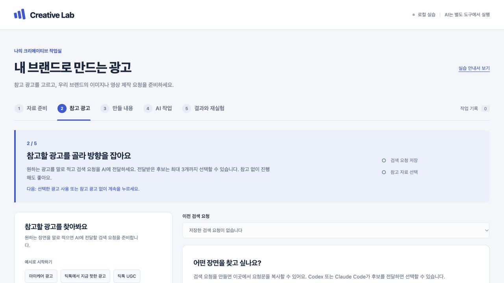

# 처음 해보는 광고 실험

**제품 사진 한 장으로 시작해, 결과를 보고 한 가지만 바꿔 다시 요청해 봅니다.** 화면의 1 → 2 → 3 → 4 → 5 순서대로 진행하세요. 이미지는 한 장을 만들어 보고, 영상은 제작 계획부터 준비합니다.

실습 앱은 내 컴퓨터에서만 열리는 화면입니다. 여기서 사진과 브랜드 정보를 모으고, 참고 광고를 골라 제작 요청을 저장합니다. 참고 광고 찾기와 이미지 만들기는 Claude 대화에서 이어갑니다. 영상은 앱에서 장면 구성과 생성 문장까지 준비하고, 실제로 만들 때는 대화에서 견적을 보고 승인합니다. 앱은 올린 결과 파일이 AI로 만들어졌는지 확인하지 않습니다.

## 앱 열기

[README 1단계](README.md#1단계-실습-폴더-열기)와 [2단계](README.md#2단계-creagen-연결하기-처음-한-번만)를 마친 새 세션에서 모델 **Opus 5.5**와 권한 모드 **Auto**를 확인한 뒤 아래 문장을 붙여 넣습니다. README 3단계 B 문장과 같으니 이미 붙여 넣었다면 건너뜁니다.

```text
ultracode 실습 앱을 켜고 브라우저로 열 주소를 알려줘. 그다음 STEP.md 순서대로 내가 화면에서 할 일을 한 단계씩 안내해줘.
```

1. Claude가 알려 준 주소(보통 `http://127.0.0.1:4381`)를 누르면 실습 앱이 열립니다. 그 번호를 다른 프로그램이 쓰고 있으면 4382처럼 다음 번호로 열립니다. 예전에 열어 둔 주소 말고 이번에 Claude가 알려 준 주소를 엽니다.
2. 실습하는 동안 앱을 켠 Claude 대화는 닫지 않습니다. 앞으로 복사하는 요청문도 이 대화에 붙여 넣습니다.
3. 끝낼 때는 같은 대화에 `실습 앱을 꺼줘`라고 붙여 넣습니다.

Claude가 프로그램 설치를 물으면 `응, 설치해줘`라고 답하고, 실행 허용 창이 뜨면 **허용**을 누릅니다. 직접 실행하는 방법은 README 맨 아래 개발자용 정보에 있습니다.

실습 앱 2단계(참고 광고)에서 AdCatch 광고를 찾으려면 Creagen 연결(README 2단계나 [Claude 앱에 Creagen 연결하기](docs/mcp-setup.md))을 먼저 마칩니다. 5분 정도 걸립니다. 실습 앱을 켠 뒤에 연결했다면 새 세션을 열고 위의 앱 열기 문장을 다시 붙여 넣습니다. 연결하지 않아도 샘플이나 내 사진으로 요청 저장까지는 해 볼 수 있습니다. 이미지를 실제로 만들려면 연결이 필요합니다.

처음 준비할 것은 두 가지입니다.

1. **제품 사진 1장:** 제품 모양과 이름이 잘 보이는 사진.
2. **브랜드 이름과 제품 이름:** 제품 설명과 피할 표현은 알고 있는 만큼 추가.

자료가 없으면 1단계 화면의 **샘플로 시작**을 누릅니다. 가상 브랜드와 단순한 제품 그림이 들어갑니다. 연습용 그림이라 실제 제품 사진이나 AI로 만든 이미지가 아닙니다. 샘플을 쓴 뒤 **브랜드 저장**을 한 번 누릅니다. 이미 입력한 내용이나 사진, 저장한 요청이 있으면 **샘플로 시작**은 눌리지 않습니다. 이때는 있는 자료로 계속합니다.

## STEP 1. 자료 준비

제품 사진과 이름을 한곳에 모읍니다.

| 확인할 것 | 할 일 |
|---|---|
| 목적 | Claude에 전달할 제품 사진과 이름 준비하기 |
| 화면에서 할 일 | **이미지 선택**을 누르거나 사진을 끌어다 놓습니다. 올린 사진은 자동으로 선택됩니다. 오른쪽에 **브랜드명**과 **제품명**을 적고 **브랜드 저장**을 누릅니다. |
| 더 넣을 수 있는 것 | 인물이 나오는 광고라면 **인물** 사진, 따라 해보고 싶은 구도가 있다면 **참고 자료** 사진을 추가합니다. 인물 사진은 본인이 사용에 동의한 사진만 씁니다. |
| 눈에 보이는 완료 기준 | 선택한 제품 사진이 보이고, **브랜드 기준** 제목 옆 표시가 **저장됨**으로 바뀌었습니다. |
| 다음 버튼 | **참고 광고 살펴보기** |
| 막힐 때 | 사진이 없으면 **샘플로 시작**을 누른 뒤 **브랜드 저장**을 누릅니다. 업로드가 안 되면 15MB 이하의 PNG, JPG, WebP, GIF 파일인지 확인합니다. |

확인한 제품 특징만 적으세요. 예를 들어 “흰색 용기, 50mL”는 적을 수 있지만, 근거 없는 효능이나 사용 후기는 넣지 않습니다.

## STEP 2. 참고 광고

원하는 광고를 말로 적으면, Claude가 AdCatch에서 실제 광고 후보를 찾아 앱에 가져옵니다. 마음에 드는 광고를 최대 3개 고르세요. 참고 광고 없이 진행해도 됩니다.

1. **예시로 시작하기**의 버튼(**마미케어 광고**, **틱톡에서 지금 핫한 광고**, **틱톡 UGC**)을 누르면 검색어와 함께 **광고 유형**과 **플랫폼**이 맞춰집니다. **어떤 광고를 참고하고 싶나요?**에 직접 적었다면 **광고 유형**과 **플랫폼**(전체 플랫폼, TikTok, Meta)을 꼭 확인합니다. 광고 유형은 처음에 **이미지 광고**로 되어 있으니, 영상 광고를 찾으려면 **영상 광고**로 바꿉니다.
2. **검색 요청 만들기** → **검색 요청문 복사**를 누릅니다.
3. 실습 앱을 켠 Claude 대화에 붙여 넣습니다. Claude가 AdCatch에서 내 브랜드를 확인한 뒤 실제 광고를 찾습니다.
4. 앱으로 돌아와 후보를 확인합니다. 아직 안 보이면 **검색 결과 새로고침**을 누릅니다. 후보는 최대 6개이며 추천 이유와 출처를 함께 볼 수 있습니다.
5. 참고할 광고를 최대 3개 선택하고 **선택한 광고 사용**을 누릅니다.



| 확인할 것 | 할 일 |
|---|---|
| 목적 | 이미지의 구도나 영상의 흐름을 참고할 광고 고르기 |
| 눈에 보이는 완료 기준 | 실제 검색 후보와 추천 이유가 보이고, 사용할 광고가 선택되어 있습니다. 또는 참고 광고 없이 진행하기로 했습니다. |
| 다음 버튼 | **선택한 광고 사용** 또는 **참고 광고 없이 계속** |
| 막힐 때 | Creagen 연결이 없으면 [Claude 앱에 Creagen 연결하기](docs/mcp-setup.md)를 보거나, 직접 가진 참고 사진으로 진행합니다. 검색 결과가 없으면 조건을 넓혀 다시 요청합니다. |

AdCatch에서는 **이미 모아 둔 광고**를 찾습니다. “지금 핫한 광고”도 TikTok 전체의 실시간 인기 순위가 아닙니다. TikTok을 골랐는데 맞는 광고가 없으면 없다고 알려 주고, Meta 광고로 바꿔 보여주지 않습니다. 광고 문구에 “UGC”라는 말이 들어 있다고 UGC 영상으로 보지 않고, 실제 영상이나 AdCatch에 저장된 분석으로 확인합니다.

**검색 요청 만들기**만 눌러서는 검색이 되지 않습니다. 복사한 요청문을 Claude 대화에 붙여 넣어야 합니다. 후보가 앱에 들어오려면 실습 앱을 켜 둔 상태여야 합니다. 연결이 안 되어 있으면 Claude는 후보를 지어내지 않고 연결이 필요하다고 알려 줍니다.

영상 광고의 썸네일(첫 화면 사진)만으로는 영상 전체를 알 수 없습니다. 장면과 움직임을 참고하려면 Claude가 원본 영상을 직접 봐야 합니다. **참고 광고 없이 계속**을 누르면 검색으로 고른 광고는 해제되고, 1단계에서 직접 등록한 참고 사진은 남습니다. 검색이 진행되는 자세한 절차는 [AdCatch 안내](docs/adcatch.md)에 있는데, Claude가 읽는 문서라 열지 않아도 됩니다. 실습 앱 없이 Claude 대화만으로 영상 한 편을 장면, 카메라, 화면 배치, 대사까지 분석해 내 제품으로 다시 만들어 보려면 [영상 다시 만들기 안내](docs/video-remake.md)를 보세요.

## STEP 3. 만들 내용

먼저 **제작 유형**에서 **이미지 한 장** 또는 **영상 제작 요청**을 고릅니다. 2단계에서 영상 광고를 골랐다면 **영상 제작 요청**이 먼저 선택되어 있고, 이미지로 바꿔도 됩니다. 그다음 아래 시작 방향 버튼 하나를 누르면 **만들 내용** 칸에 예시 요청이 들어갑니다. 문장을 조금만 고쳐 보세요. 버튼 없이 직접 적어도 됩니다.

| 시작 방향 | 필요한 사진 | 처음 해볼 내용 |
|---|---|---|
| 제품 중심 | 제품 | 제품이 잘 보이는 배경과 구도 |
| 참고 구도 활용 | 제품 + 참고 자료 | 직접 등록한 사진이나 2단계에서 고른 광고의 배치, 여백을 우리 제품에 맞게 활용 |
| 인물과 제품 | 제품 + 인물 | 인물과 제품이 함께 나오는 장면 |

| 확인할 것 | 할 일 |
|---|---|
| 목적 | 이미지에서 보여 줄 장면 또는 영상의 길이와 형식 정하기 |
| 화면에서 할 일 | 제작 유형과 시작 방향을 고르고 **만들 내용**을 고칩니다. 영상이면 길이, 비율, 스타일도 고릅니다. 오른쪽 **보내기 전에 확인하세요**에서 이번에 쓸 사진과 참고 광고를 확인합니다. |
| 눈에 보이는 완료 기준 | **만들 내용**에 만들 장면이 적혀 있고, 고른 방향에 필요한 사진이나 참고 광고가 선택되어 있습니다. |
| 다음 버튼 | **요청 저장하고 AI 작업으로** |
| 막힐 때 | **참고 구도 활용**이 눌리지 않으면 2단계에서 광고를 고르거나 1단계에서 참고 사진을 추가합니다. **인물과 제품**이 눌리지 않으면 1단계에서 인물 사진을 추가하거나 **제품 중심**으로 바꿉니다. |

이미지 요청 예: “밝은 베이지색 배경에 제품을 가운데 놓아 줘. 제품 이름이 잘 보이게 하고 문구는 넣지 말아 줘.”

**영상 제작 요청**을 고르면 **영상 길이** 15, 20, 30초, **화면 비율** 9:16, 1:1, 16:9, **영상 스타일** UGC 사용 장면(사람이 제품을 쓰는 장면 중심), 제품 중심, 직접 지정 중에서 고를 수 있습니다. 화면에 제안된 값을 확인하고 원하는 형식으로 바꾸세요. 예를 들어 “20초, 9:16, UGC 형식으로 제품을 소개하되 실제 사용 후기처럼 꾸미지 말아 줘”라고 적을 수 있습니다. 이 값은 만들고 싶은 목표입니다. 실제로 만들 도구가 이 길이와 비율을 지원하는지는 만들기 전에 Claude가 확인합니다.

참고 영상을 골랐다면 원본의 화면 구성, 카메라, 동작, 장면 길이는 따르고 인물, 제품, 문구, 로고는 내 것으로 바꿉니다. 다른 브랜드의 문구, 로고, 상표, 제품, 인물 얼굴은 쓰지 않습니다.

## STEP 4. AI 작업

이미지와 영상은 이 단계에서 하는 일이 다릅니다.

| 확인할 것 | 이미지 | 영상 |
|---|---|---|
| 목적 | 고른 자료로 이미지 만들기 | 영상 제작 계획(장면 구성과 생성 문장) 다듬기 |
| 화면에서 할 일 | **요청문 복사**를 눌러 실습 앱을 켠 Claude 대화에 붙여 넣습니다. | **영상 제작 패키지 준비**에서 **요청문 복사**를 눌러 같은 Claude 대화에 붙여 넣습니다. |
| Claude가 하는 일 | 제품 사진과 참고 광고를 직접 보고 생성 문장을 씁니다. 만들기 전에 크레딧 견적과 남은 크레딧을 보여주고 멈춥니다. 내가 `승인, 진행해줘`라고 답하면 이미지를 만듭니다. | 제품 사진과 고른 참고 영상을 확인해 장면별 대사와 생성 문장을 다듬습니다. 보지 못한 장면은 지어내지 않고 비워 둡니다. |
| 눈에 보이는 완료 기준 | 만든 이미지가 내 컴퓨터에 저장되고, Claude가 파일 위치를 알려 줬습니다. Creagen 연결이 없으면 생성 문장까지만 남습니다. | 영상 구성 계획과 생성 문장 초안이 저장됐습니다. 영상 파일은 아직 없습니다. |
| 다음 행동 | **결과 등록하러 가기** | 이 단계에서는 영상을 만들지 않고 크레딧도 쓰지 않습니다. 영상을 실제로 만들려면 아래 **영상을 실제로 만들려면**을 따릅니다. |
| 막힐 때 | Claude가 파일을 못 찾으면 실습 앱을 켠 대화인지, 같은 실습 폴더인지 확인합니다. | 참고 영상을 열지 못하면 Claude가 확인한 자료만으로 준비하고, 보지 못한 장면은 비워 둡니다. |

영상 요청이면 **저장된 요청문과 기술 정보 보기**를 펼친 뒤 **영상 구성 계획 내려받기**, **영상 프롬프트 초안 내려받기**로 저장된 파일을 받아 볼 수 있습니다.

**영상 제작 패키지는 제작 계획입니다.** 요청을 저장하면 장면별 시간과 역할이 담긴 초안이 만들어지고, 대사와 참고 영상에서 본 내용은 Claude가 확인한 뒤 채웁니다. 초안에 처음 들어 있는 장면은 앱이 제안한 것이며 원본 광고에서 본 장면이 아닙니다. 이 단계에서는 영상을 만들지 않고 크레딧도 쓰지 않습니다.

**영상을 실제로 만들려면** [영상 다시 만들기 안내](docs/video-remake.md)의 ⑥을 따릅니다. 같은 대화에 아래 문장을 붙여 넣으면 Claude가 쓸 도구와 크레딧 견적, 남은 크레딧을 보여주고 멈춥니다. 내가 `승인, 진행해줘`라고 답할 때만 영상을 만들고 크레딧을 씁니다. 참고로 10초 영상 한 편은 약 585 크레딧이었습니다.

```text
방금 준비한 영상 제작 패키지로 영상을 만들어 보려고 해. 먼저 쓸 도구와 필요한 입력을 확인하고, 크레딧 견적과 내 남은 크레딧을 알려줘. 만들기는 내가 승인한 뒤에 해줘.
```

이미지도 앱이 직접 만들지 않습니다. 요청을 저장하거나 3단계의 **입력한 요청 전체 보기**를 펼쳐 본 것은 AI가 분석하거나 만든 결과가 아닙니다. 이미지를 만들 수 있는지와 드는 크레딧은 Claude가 견적으로 먼저 알려 줍니다. 비밀번호나 키는 요청문이나 대화에 붙여 넣지 않습니다.

## STEP 5. 결과와 재실험

4단계에서 만든 이미지나 영상 파일을 앱에 올리고, 다음에 바꿀 한 가지를 정합니다. 영상은 4단계 **영상을 실제로 만들려면**의 방법으로 만든 파일이 있을 때만 올립니다. 같은 사진과 요청을 이어서 쓰되, 다음에는 한 가지만 바꿉니다.

5단계에는 마지막으로 저장하거나 고른 요청이 열립니다. 다른 요청에 결과를 올리려면 오른쪽 위 **작업 기록**을 누르고, 목록에서 요청을 고른 뒤 **결과와 재실험 열기**를 누릅니다. 다시 실험한 요청은 처음 요청과 이름이 같을 수 있으니 이름 아래 저장 시간으로 구분합니다.

| 확인할 것 | 할 일 |
|---|---|
| 목적 | 결과를 보고 다음에 바꿀 한 가지 정하기 |
| 화면에서 할 일 | 이미지 요청은 **결과 이미지 선택**, 영상 요청은 **결과 파일 선택**으로 파일을 올립니다. 제품 모양, 이름, 구도와 배경을 확인한 뒤 **바꿀 점 하나**에 다음에 바꿀 내용을 적습니다. |
| 바꿀 점 예시 | “제품과 구도는 유지하고 배경만 연한 파란색으로 바꿔 줘.” |
| 눈에 보이는 완료 기준 | 올린 파일이 화면에 보이고, **같은 자료로 다시 실험**을 누르면 바꿀 내용이 적힌 새 초안이 3단계에 열립니다. 새 요청을 저장하고 다음 결과도 올리면 이전 결과와 나란히 비교할 수 있습니다. |
| 다음 버튼 | **같은 자료로 다시 실험** → 3단계에서 내용 확인 → **요청 저장하고 AI 작업으로** → 새 요청문을 Claude 대화에 붙여 넣습니다. |
| 막힐 때 | 결과 파일이 없으면 4단계로 돌아가 Claude에게 만든 파일이 어디 있는지 묻습니다. 이미지는 15MB 이하의 PNG, JPG, WebP, GIF, 영상은 50MB 이하의 MP4, WebM을 올릴 수 있습니다. 영상 구성 계획이나 생성 문장 초안은 결과 파일이 아니니 올리지 않습니다. |

**직접 등록한 결과**는 내가 파일을 올렸다는 뜻입니다. 앱은 그 파일이 AI로 만들어졌는지, 크레딧을 얼마나 썼는지 확인하지 않습니다. **같은 자료로 다시 실험**은 3단계에 다음 요청의 초안을 여는 버튼이며, 누른다고 바로 만들어지지 않습니다.

제품과 구도, 배경을 한꺼번에 바꾸면 무엇 때문에 결과가 달라졌는지 알기 어렵습니다. 배경 → 문구 → 배치처럼 한 번에 하나씩 바꾸고, 이전 결과는 남겨 두세요.

## 잠시 멈췄다가 이어하기

아직 저장하지 않은 입력은 이 브라우저에 자동 보관됩니다. 화면 맨 아래의 보관 상태를 확인한 뒤 닫으세요. 다시 할 때는 같은 실습 폴더에서 Claude에 `실습 앱을 켜고 주소를 알려줘`라고 붙여 넣고, 같은 브라우저로 Claude가 알려 준 주소를 엽니다. 주소의 숫자가 지난번과 다르면 브라우저에 보관된 입력은 보이지 않을 수 있습니다. 이때도 올린 사진, 저장한 브랜드 정보와 요청은 실습 폴더에 그대로 있습니다.

이미지는 **요청 준비 → 견적 확인과 승인 → 이미지 확인 → 결과 올리기 → 한 가지 바꾼 다음 요청**까지 해 볼 수 있습니다. 영상은 앱에서 **참고 광고 선택 → 영상 길이와 형식 고르기 → 제작 계획 준비**까지 하고, 실제로 만들 때는 대화에서 견적을 보고 승인합니다. 연습으로 아무 파일이나 올려 봤다면 그 파일은 실제 결과로 보지 않습니다.

파일 위치와 연결 구조가 필요하면 [실습 앱 상세 안내](docs/web-app.md)를, 영상과 성과 비교까지 해보려면 [확장 실습](docs/workshop.md)을 읽으세요.
